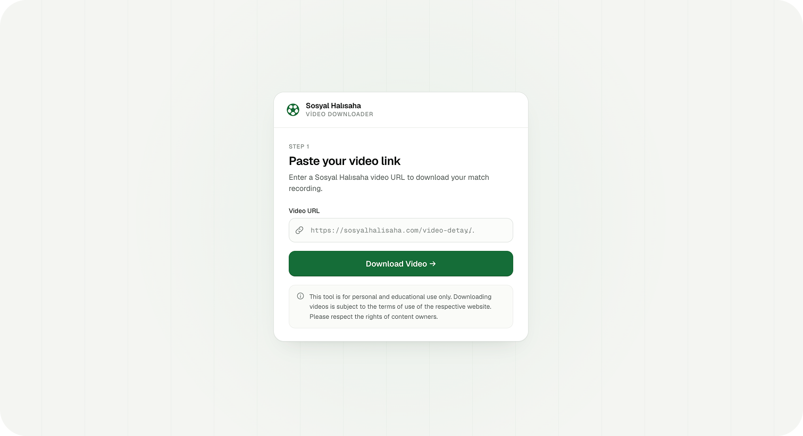

<p align="center" class="logo-section">

</br>


<p align="center">
Unofficial, self-hosted Node.js web app (Express, EJS) for saving your own football match recordings (halı saha maç videoları) from sosyalhalisaha.com match pages. Not affiliated with Sosyal Halısaha.<br>

<br/>
<br/>

</p>

<p align="center">
<a align="center" href="https://halitsever.github.io/sosyal-halisaha-downloader/">Documentation</a>
  </p>
</p>

> [!WARNING]
> This project is intended solely for educational and personal development purposes. It is not affiliated with or endorsed by any website, and is not intended for commercial use or distribution of any content from the site.
> The code is provided as an example of how a user might archive their own publicly available match videos from the site. Downloading, sharing, or archiving content that does not belong to you may violate the platform’s Terms of Use and applicable copyright or data protection laws.

<p align="center">

</p>

- [**Download match videos**](#) - Scrape match videos from sosyalhalisaha.com
- **Preview before saving**: paste a match page URL, the app shows the video with its title and uploader, then saves it as `match-record.mp4`.
- **Self-hosted**: a small Express server with EJS pages. It listens on `PORT` (default `3000`) and only accepts `https://` URLs.

<p align="center">
  
</p>

<p align="center">
  
</p>

<p align="center" >

</p>

Package installation:

```bash
npm i
```

Running for development:

```bash
npm run dev
```

<p align="center" href="https://github.com/halitsever/sosyal-halisaha-downloader/issues">

</p>

<p align="center">
Found a bug or have an idea? Open an <a href="https://github.com/halitsever/sosyal-halisaha-downloader/issues">issue</a>.<br/>
Read the <a href=".github/CONTRIBUTING.md">contributing guide</a> before sending a pull request.
</p>

<p align="center">

</p>

<p align="center">

</p>

<p align="center">
  MIT LICENSE | <a href="https://github.com/halitsever">Halit Sever</a>
</p>
